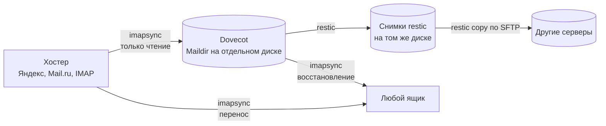

# mail_backup

[](https://github.com/boytsovau/mail_backup/actions/workflows/tests.yml)
[](https://www.python.org/)
[](https://fastapi.tiangolo.com/)
[](https://www.sqlalchemy.org/)
[](https://www.sqlite.org/wal.html)
[](https://htmx.org/)
[](https://www.chartjs.org/)
<br>
[](https://imapsync.lamiral.info/)
[](https://restic.net/)
[](https://www.dovecot.org/)
[](https://nginx.org/)
[](https://ubuntu.com/)
[](LICENSE)

Веб-сервис для резервного копирования почтовых ящиков по IMAP: бэкап на отдельный
диск сервера, история в снимках restic с копиями на другие серверы, восстановление
из бэкапа и прямой перенос между хостерами. Всё управляется из браузера.

Движок — [imapsync](https://github.com/imapsync/imapsync), хранилище —
локальный [Dovecot](https://www.dovecot.org/) с Maildir, история —
[restic](https://github.com/restic/restic).

## Возможности

- **Бэкап без изменений на хостере.** Письма копируются со всеми флагами и датами;
  на стороне хостера ничего не удаляется, не перемещается и не помечается прочитанным.
  Опасные флаги imapsync отклоняются в коде ещё до запуска.
- **Бэкап по умолчанию ничего не удаляет.** Письма, удалённые на хостере, остаются в бэкапе
  навсегда — даже если с ящика пропадёт вся почта. По желанию у ящика можно включить
  зеркалирование удалений: тогда удалённое хранится в снимках restic на срок хранения.
- **Хостеры:** Яндекс, Mail.ru и любой IMAP-сервер с ручной настройкой.
- **Расписание по каждому ящику**, ограничение числа одновременных задач, пауза,
  остановка, живой прогресс с оценкой оставшегося времени и лог каждого запуска.
- **Снимки restic** после каждого бэкапа, срок хранения в днях, ежедневная очистка,
  выгрузка копий на другие серверы по SFTP, проверка целостности.
- **Восстановление** из последнего бэкапа или из снимка на выбранную дату — в тот же
  ящик или в любой другой, по тем же папкам или в одну отдельную папку.
- **Перенос** ящика напрямую от одного хостера к другому.
- **Пробный прогон** перед любым восстановлением или переносом: видно, сколько писем
  будет скопировано, без записи.
- **Просмотр бэкапа почтовым клиентом** (Thunderbird, Apple Mail и т. п.) только для
  чтения — права ограничивает ACL Dovecot.
- **Оценка места**: размеры ящиков по папкам без копирования писем и рекомендуемый
  размер диска под бэкапы.
- **Графики и обзор**: объёмы по дням, размер ящиков во времени, длительность и ошибки,
  состояние каждого ящика («в порядке», «просрочен», «сбой», «нет снимка»).
- **Все настройки — в веб-панели**: ящики, расписания, сроки хранения, серверы для
  выгрузки, SSH-ключ, часовой пояс, смена пароля администратора.

## Как это устроено



- **Веб-панель** (FastAPI, Jinja2, htmx) работает на `127.0.0.1:8080` за nginx с HTTPS.
- **Воркер** — отдельный сервис systemd: очередь, расписание, запуск imapsync и restic.
- Общая база — SQLite в режиме WAL. Пароли ящиков шифруются (Fernet), пароль
  администратора хранится как хеш argon2, в imapsync пароли передаются через файлы,
  а не в командной строке.
- Для каждого ящика в локальном Dovecot заводится своя учётка; Dovecot по умолчанию
  слушает только `127.0.0.1`.

## Установка

Сервер — Ubuntu 26.04 (поддерживается и Dovecot 2.3 из Ubuntu 24.04). Docker не нужен:
установщик ставит пакеты, imapsync (с проверкой SHA256), restic, Dovecot, сервисы systemd
и nginx с самоподписанным сертификатом.

```bash
sudo install -d -o "$USER" -g "$USER" -m 0755 /opt/mail_backup
git clone git@github.com:boytsovau/mail_backup.git /opt/mail_backup

# тестовый сервер — бэкапы на системном диске
sudo /opt/mail_backup/deploy/install.sh --mode dev

# рабочий сервер — бэкапы только на отдельном диске, смонтированном в /srv/mail_backup
sudo /opt/mail_backup/deploy/install.sh --mode prod
```

В конце установщик печатает адрес панели и одноразовую ссылку, по которой задаются
логин и пароль администратора. Подробности, обновление и чек-лист проверки —
в [deploy/INSTALL.md](deploy/INSTALL.md).

## Разработка

```bash
python3.13 -m venv .venv && .venv/bin/pip install -e '.[dev]'
cp .env.example .env
.venv/bin/mail-backup init            # каталоги, ключи, БД
.venv/bin/mail-backup set-admin admin
.venv/bin/pytest
.venv/bin/uvicorn mail_backup.main:app --reload
```

В тестах imapsync подменяется скриптом-заглушкой; тест с restic выполняется,
только если restic установлен. Решения и архитектура подробно описаны
в [CLAUDE.md](CLAUDE.md).

## Состояние

Готово: бэкап, расписание, веб-панель, восстановление и перенос, графики, снимки
restic, установщик. Покрыто тестами, бэкапы идут на тестовом сервере с Dovecot 2.3; часть
возможностей (выгрузка по SFTP, просмотр почтовым клиентом, установка на Ubuntu 26.04)
вживую ещё не проверялась — список в [deploy/INSTALL.md](deploy/INSTALL.md).

## На чём построено

| Компонент | Зачем |
|---|---|
| [imapsync](https://imapsync.lamiral.info/) ([GitHub](https://github.com/imapsync/imapsync)) | копирование писем между IMAP-серверами |
| [Dovecot](https://www.dovecot.org/) | локальный IMAP-сервер, хранилище бэкапов в Maildir |
| [restic](https://restic.net/) ([GitHub](https://github.com/restic/restic)) | снимки с дедупликацией, срок хранения, копии на другие серверы |
| [FastAPI](https://fastapi.tiangolo.com/) + [Uvicorn](https://www.uvicorn.org/) | веб-панель |
| [SQLAlchemy 2](https://www.sqlalchemy.org/) + [SQLite](https://www.sqlite.org/) | база данных |
| [pydantic-settings](https://docs.pydantic.dev/latest/concepts/pydantic_settings/) | настройки из окружения |
| [Jinja2](https://jinja.palletsprojects.com/) | шаблоны страниц |
| [htmx](https://htmx.org/) | живое обновление страниц без своего JavaScript-фреймворка |
| [Chart.js](https://www.chartjs.org/) | графики |
| [cryptography](https://cryptography.io/) (Fernet) | шифрование паролей ящиков |
| [argon2-cffi](https://argon2-cffi.readthedocs.io/) | хеш пароля администратора |
| [itsdangerous](https://itsdangerous.palletsprojects.com/) | подпись cookie сессии |
| [python-multipart](https://github.com/Kludex/python-multipart) | разбор форм |
| [nginx](https://nginx.org/) | HTTPS-прокси к панели |
| [pytest](https://docs.pytest.org/) | тесты |

## Лицензия

[MIT](LICENSE).
